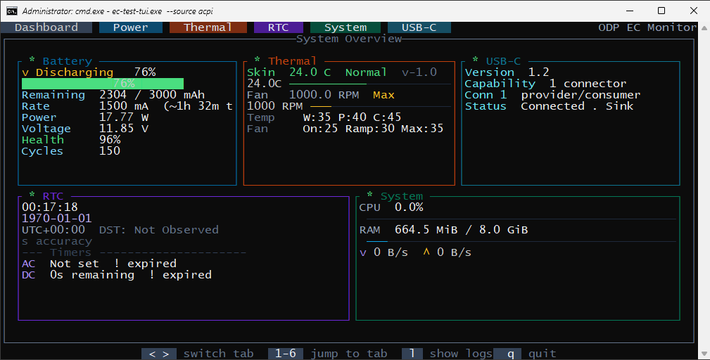
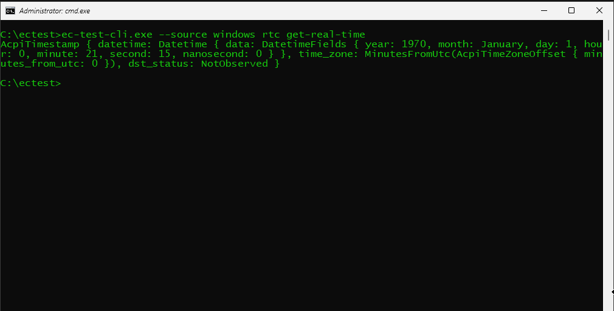

# Embedded Controller

This section covers how to get started developing and testing with the virtual Embedded Controller (EC).

## What this is
ODP provides a fully virtual embedded controller modeled on a QEMU 32-bit RISC-V machine. This also includes, in addition to the virtual UART bus provided by QEMU, a virtual I2C bus and virtual GPIOs.

These virtual peripherals present a memory-mapped register interface to the EC, just like real hardware, but send data over a socket acting as the virtual wire.

Along with a host OS running inside a QEMU ARM instance, this enables a completely virtual end-to-end development environment.

## What this is not
The intent of this virtual EC is to aid in the development and testing of **application logic** sitting on top of hardware.

For example, a properly designed thermal management system in Rust can be written largely independently of the underlying hardware (as in, it shouldn't necessarily depend on the architecture of the microcontroller, specific sensors, which bus they use, etc.).

Likewise, logic for communicating with the host over a transport such as HIDI2C shouldn't necessarily be dependent on details of the specific underlying I2C peripheral as those details are abstracted away through generic traits.

Thus, this virtual EC is **NOT** intended to emulate the specific hardware quirks or timing details of any specific platform. For such a use case, tools like Renode would be more appropriate.

## How to use it
First, check out [QEMU setup](../qemu/qemu-setup.html) for the basics of getting started with QEMU.

Once you have the repo cloned and the devcontainer set up, you can verify host-to-EC communications by following these steps:

- Run `make all` to build UEFI firmware and secure services.
- Run `make run_ec` which will build the `dev-qemu` platform in the `mod/ec` folder (the `odp-embedded-controller` submodule) and start a headless QEMU instance running the firmware on the RISC-V `ec` machine while displaying logs.
- In a separate terminal, run `make run_os QEMU_DISPLAY=gtk` which will download our bundled WinVOS image containing all drivers and EC applications needed to interface with the EC, then boot it in an ARM `virt` QEMU instance running in a display window (alternatively, if you prefer connecting remotely via VNC, `make run_os` alone will start a headless instance with no local display window). This QEMU instance will automatically connect to the EC QEMU instance via sockets for virtual bus communications.
- In the WinVOS terminal, run `cd C:\ectest`.
- Run `ec-test-tui.exe --source acpi` (which ultimately goes through the virtual serial/UART bus). If everything is working correctly, you should see the TUI app open with an overview of EC subsystems with a green `*` indicating successful communication (don't worry if the data seems nonsensical; that is because some subsystems currently provide more realistic mock data than others):

	
- To verify virtual I2C/GPIO communication, run `ec-test-cli.exe --source windows rtc get-real-time` (currently, only the time-alarm service supports HIDI2C), which goes through a custom Windows driver that ultimately talks HID over I2C. If successful, you should receive output that looks like:

	

If everything is working, then you have successfully set up your environment and can begin developing on your own. The best way to start is by navigating to `mod/ec/platform/dev-qemu/src` to see the current, basic reference implementation provided by ODP and start tweaking it to suit your needs. Running `make run_ec` again will build and launch your changes, and you can continue using the test apps running in the host QEMU instance to test your changes.

While the nitty-gritty details of how this all works under the hood aren't required for development, if you're curious, continue reading below.

## How it works
At its core is a modified QEMU binary which adds a few nice features:

- An emulated I2C target peripheral
- An emulated I2C controller peripheral
- An emulated GPIO peripheral
- A new RISC-V `ec` machine which wires up the I2C target and GPIO peripherals as memory-mapped registers
- A modified ARM `virt` machine which additionally wires up the I2C controller and GPIO peripherals as memory-mapped registers

The important thing to note is that the peripherals expose a socket allowing two QEMU instances or any other external program to connect. This is what enables the QEMU ARM host machine to connect its virtual I2C controller peripheral to the QEMU EC machine's virtual I2C target peripheral. This mirrors how the existing virtual UART peripherals in QEMU work.

Fortunately, knowing the nitty-gritty of how this works isn't required if you just want to get started developing your EC application logic. For those who are curious or need to modify QEMU themselves, the relevant repos and details are included below:

- [odp-qemu-builder](https://github.com/OpenDevicePartnership/odp-qemu-builder): This is where ODP modifications to QEMU live as they are not yet upstreamed. The patch for I2C and GPIO emulation can be found [here](https://github.com/OpenDevicePartnership/odp-qemu-builder/blob/main/qemu-bus-emulation.patch). As mentioned, this is responsible for implementing the new peripherals and wiring them up into the respective machines.
- [qemu-riscv-rs](https://github.com/kurtjd/qemu-riscv-rs): This repo contains a peripheral access crate (PAC) and Embassy hardware abstraction layer (HAL) targeting the QEMU `ec` machine. The PAC and HAL hide the specific memory-mapped registers of the virtual peripherals, so knowledge of them is not required for writing application code. However, if one needs to modify the register map presented by the QEMU `ec` machine, then the [SVD file](https://github.com/kurtjd/qemu-riscv-rs/blob/main/qemu-riscv-pac/qemu-riscv.svd) **MUST** be updated as well since this is the source of truth from which the PAC is generated and the HAL is built upon.
- [odp-embedded-controller](https://github.com/OpenDevicePartnership/odp-embedded-controller): This contains reference EC implementations for several platforms supported by ODP, including, of course [dev-qemu](https://github.com/OpenDevicePartnership/odp-embedded-controller/tree/main/platform/dev-qemu). This is the primary repo that EC firmware developers will need to concern themselves with as this is where application logic lives. Currently, the `dev-qemu` platform contains mock/virtual sensors, fans, batteries, and a real-time clock (RTC) to demonstrate the ODP [embedded-services](https://github.com/OpenDevicePartnership/embedded-services). Additionally, the MCTP/UART service and HIDI2C time-alarm service are implemented over the virtual bus peripherals to demonstrate communication with a host.
- [odp-platform-common](https://github.com/OpenDevicePartnership/odp-platform-common/tree/main/ec): The TUI and CLI apps that interface with the EC from the host OS live here. The apps are designed so that the underlying "source" (or transport) is configurable at runtime depending on the platform (for example, direct serial/UART, ACPI, Windows class interface, etc.). These are great tools to test host-to-EC communications end-to-end.
